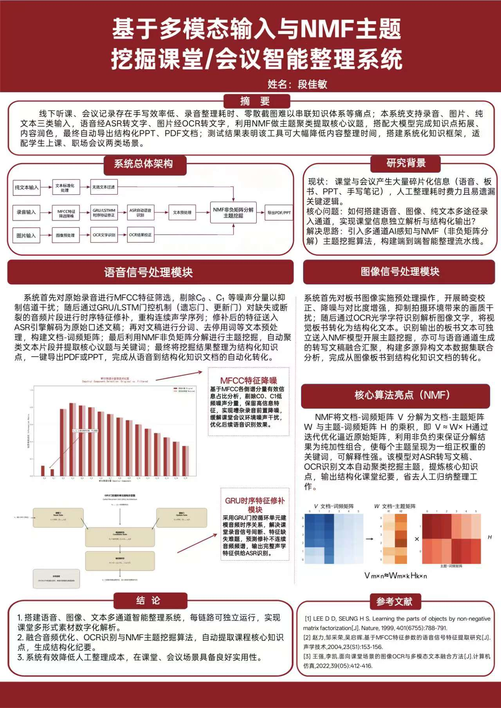

智能课堂/会议整理系统

项目简介

本项目针对传统课堂与会议中“手写效率低、录音整理耗时、零散截图难以串联”的痛点，从零开发了一套支持“文本+图片+录音”多模态输入的智能知识提取系统。

传统工具只能进行单一的文字转换，而本系统构建了一条完整的自动化流水线：前端采用极简的 SaaS 风格交互，后端基于 Django 框架接收多模态数据，分别调用 PaddleOCR 与 Whisper 完成信息提取。为了保证最终生成内容的质量，系统结合了中文分词与机器学习算法进行降噪去重，随后接入 DeepSeek 大模型进行语义重构与知识引申。最终，通过底层操作 Word 文档 XML 结构，一键生成排版极其规范、无需二次调整的精美 Word 讲义。

海报说明：顶部海报展示了系统的理论架构原型；在实际工程落地中，为了保证效率与稳定性，采用了成熟开源模型（Whisper、PaddleOCR）进行替代，但核心的 NMF 主题挖掘算法 已在代码中真实复现。

核心功能详解

1. 多模态融合输入：打破传统系统单一输入的限制。用户可以同时或独立提交文本内容、上传包含板书的图片（支持 JPG/PNG 格式），以及上传长达数十分钟的课堂录音。
2. 图像解析与容错处理：本地化部署 PaddleOCR 引擎。在工程实现中，我不仅实现了图片转文字，还特别针对图像读取的兼容性进行了重构，彻底解决了带透明通道（RGBA）的图片常常导致程序直接崩溃的恶性 Bug。
3. 高精度语音转写：利用 Whisper 模型进行本地 ASR（自动语音识别），自动剥离语音中的背景杂音，将大段录音精准转化为文字稿。
4. NMF 算法降噪与提纯：这是本项目的算法核心之一。若直接将长文本喂给大模型，不仅 Token 消耗巨大，AI 也容易抓不住重点。我引入了 jieba 分词与停用词过滤，结合 TF-IDF 提取文本特征，并运用非负矩阵分解（NMF）进行主题聚类。这一步有效剔除了“然后”、“那个”等大量口语废话，只保留最高密度的知识干货。
5. 大模型语义重构：将提纯后的干货送入 DeepSeek 大模型。通过精心设计的结构化 Prompt 工程，让 AI 不仅做简单的总结，更对原文进行举例引申，帮助用户真正吃透知识。
6. 强迫症福音的 Word 排版：彻底解决大模型输出夹杂 Markdown 符号（如 #、*）导致 Word 排版杂乱的问题。通过正则表达式彻底清洗文本，并利用 python-docx 库底层操作文档格式，强制全篇文字使用微软雅黑、11 号字、绝对不加粗，并自动留出舒适的行距，实现“一键生成可用文档”。

系统运行原理

整个系统的运作分为五个严密的层级：

1. 输入层：前端页面接收用户提交的文本、图片和音频文件，打包成请求发送至后端。
2. 预处理层：Django 后端将图片传给 PaddleOCR，音频传给 Whisper，把非文字信息统一转化为纯文本。
3. 算法降噪层：使用 TF-IDF 提取特征，通过 NMF 矩阵分解技术挖掘核心主题词，过滤低价值信息。
4. 大模型层：将洗过的干货送入 DeepSeek，进行长文本理解、结构化重组和知识引申。
5. 工程输出层：后端用正则清除冗余符号，调用 python-docx 重新赋予排版格式，触发浏览器直接下载。

项目目录结构

· note_app/ai/：存放所有的本地 AI 模块代码。包含 asr.py（语音识别）、ocr.py（图像识别）、nmf.py（算法降噪）。
· note_app/templates/home.html：前端页面。使用 Tailwind CSS 构建的极简界面，包含丝滑的附件上传与预览卡片交互。
· note_app/views.py：整个网站的大脑。负责接收前端请求、调度 AI 模块、清洗数据以及生成最终的 Word 文档。
· note_app/secret_key.py：安全存放 API 密钥的私密文件，配合 .gitignore 已确保绝对不会泄露到互联网上。
· db.sqlite3：本地测试用的轻量级数据库。

核心技术栈

· 后端核心：Python 3.13, Django 6.0
· 前端交互：HTML5, Tailwind CSS (CDN), 原生 JavaScript
· AI 与算法：OpenAI SDK (DeepSeek), PaddleOCR, Whisper, Scikit-learn (NMF, TF-IDF)
· 文档处理：python-docx, 正则表达式 (Regex)

本地运行指南

1. 克隆代码后，打开终端安装依赖库：
   pip install django openai python-docx paddleocr openai-whisper jieba scikit-learn
2. 配置你的专属 API 密钥：
   在 note_app 文件夹下新建一个名为 secret_key.py 的文件，在里面写上：DEEPSEEK_KEY = "sk-你的真实密钥"
3. 启动服务器：
   python manage.py runserver
4. 打开浏览器，访问 http://127.0.0.1:8000 即可体验本系统。
